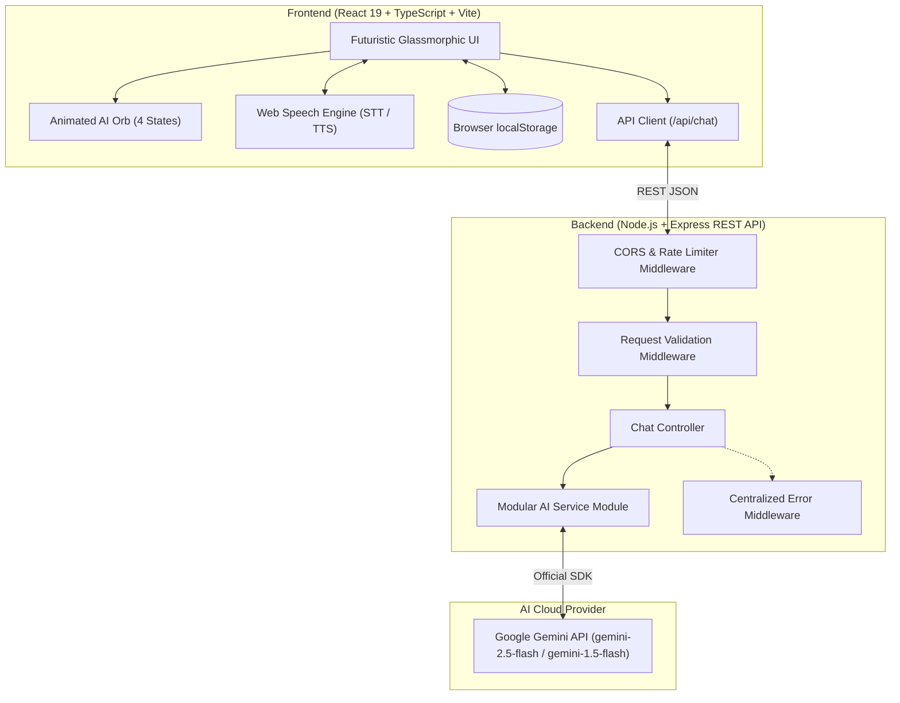
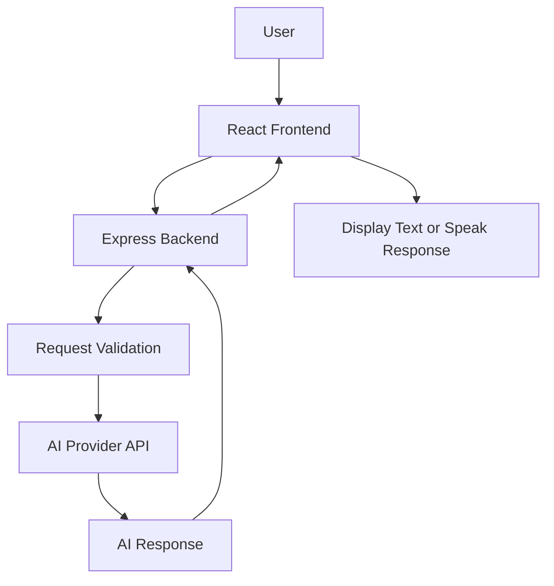

<<<<<<< HEAD
# 🚀 NOVA AI — Personal AI Assistant

<div align="center">


<br/>

**"Your Voice. Your Intelligence. Your Assistant."**

[](https://react.dev/)
[](https://www.typescriptlang.org/)
[](https://vitejs.dev/)
[](https://tailwindcss.com/)
[](https://expressjs.com/)
[](https://aistudio.google.com/)
[](https://developer.mozilla.org/en-US/docs/Web/API/Web_Speech_API)
[](LICENSE)
=======
<div align="center">


<br/>

### ⚡ THINK SMARTER. SPEAK NATURALLY. DO MORE.

**An intelligent AI assistant designed to make conversations, learning, and everyday digital tasks easier.**

<br/>

<a href="https://github.com/ThirusenthilkumarC">

</a>


<br/><br/>

<a href="#-overview">Overview</a> • <a href="#-features">Features</a> • <a href="#-technology-stack">Tech Stack</a> • <a href="#-installation">Installation</a> • <a href="#-roadmap">Roadmap</a>

<br/><br/>


>>>>>>> 4717820e0b6f3ae7b5e60552069ffb68e5fef845

</div>

---

<<<<<<< HEAD
## 🌟 Overview

**NOVA AI** is a futuristic, full-stack personal AI assistant web application inspired by sci-fi holographic interfaces and advanced conversational intelligence. It features real-time voice interactions, bilingual English and Tamil communication, specialized assistant modes for programming and academia, and an interactive animated AI core orb.

Built with a modern decoupled architecture consisting of a **React + Vite + TypeScript** frontend and an **Express.js + Google Gemini** backend, NOVA AI provides an authentic, responsive, and secure AI companion experience.

---

## ✨ Key Features

### 🎙️ Real Voice Interaction
- **Speech-to-Text (Voice Input)**: Speak directly into your microphone using the Web Speech Recognition API (`SpeechRecognition` / `webkitSpeechRecognition`).
- **Text-to-Speech (Spoken Responses)**: Listen to NOVA's responses with natural inflection using the browser `SpeechSynthesis` engine.
- **Natural Voice Filtering**: Automatic stripping of markdown code blocks and symbols during speech synthesis to ensure conversational auditory responses.
- **Voice Customization**: Select system voices, speech rate, and pitch from the Settings panel.

### 🌐 Bilingual Intelligence (English & தமிழ்)
- Full support for both **English** and **Tamil (தமிழ்)** scripts.
- Understands natural Tamil, Tanglish (Tamil in Latin script), and formal Tamil.
- Technical code keywords and syntax remain in standard English for executable integrity.

### 🔮 Interactive 4-State Animated AI Orb
An original, multi-layer holographic energy orb reflecting NOVA's live mental state:
- **`IDLE`**: Calm pulsating cyan breathing glow with orbital particles.
- **`LISTENING`**: Expanding acoustic ripples and radiant cyan aura when recording speech.
- **`THINKING`**: High-velocity holographic gyroscopic spinning rings with violet energy trails.
- **`SPEAKING`**: Audio-reactive dynamic pulsing wave with electric blue core.
- Fully accessible with **Reduced Motion** support.

### 🎯 Three Dedicated Assistant Modes
1. **General AI Assistant (`general`)**: Friendly, articulate, and concise general companion for everyday inquiries and workflows.
2. **Coding Assistant (`coding`)**: Senior Software Architect mode. Diagnoses bugs, explains runtime errors, writes clean algorithms, and formats code with syntax highlighting, language badges, and 1-click copy.
3. **Study Assistant (`study`)**: Academic Professor mode. Breaks down complex Computer Science and university theories using real-world analogies, generates revision summaries, and creates self-check quiz questions.

### 💾 Browser Conversation Management
- Stored privately in `localStorage` — no external database overhead or credential leakage.
- Automatic smart title generation for every new chat.
- Search conversations in real-time.
- Inline conversation renaming and individual deletion.
- One-click **JSON Data Export** for backups.
- Clear all history with confirmation safety modal.

### 🛡️ Enterprise Security & Graceful Degradation
- **Zero Client-Side Credentials**: API keys are strictly loaded by the Express backend from environment variables (`.env`).
- **Interactive Demo Mode**: When an API key is not configured, NOVA AI runs in a transparent Demo Mode. It demonstrates voice recognition, UI animations, and contextual responses without fabricating fake AI claims.
- **Rate Limiting & Payload Guards**: Request size limits (1MB) and IP-based rate limiting (60 requests/15 min) prevent abuse and DDoS attacks.

---

## 🏛️ System Architecture



---

## 📁 Project Structure

```
nova-ai/
├── frontend/                     # React + Vite + TypeScript Frontend
│   ├── src/
│   │   ├── components/           # Reusable UI Components
│   │   │   ├── AiOrb.tsx         # Multi-layer animated AI Orb
│   │   │   ├── ChatArea.tsx      # Chat stream & hero empty state
│   │   │   ├── ChatMessageBubble.tsx # Message cards with Markdown & TTS
│   │   │   ├── CodeBlock.tsx     # Syntax code block with copy action
│   │   │   ├── ConfirmModal.tsx  # Modal for destructive actions
│   │   │   ├── Header.tsx        # Top status bar, language & mode pills
│   │   │   ├── MessageInput.tsx  # Glass composer, mic & send buttons
│   │   │   ├── SettingsModal.tsx # Voice, language, AI status modal
│   │   │   ├── Sidebar.tsx       # Collapsible drawer with chat history
│   │   │   └── Toast.tsx         # Floating notifications
│   │   ├── hooks/
│   │   │   ├── useConversations.ts # LocalStorage history hook
│   │   │   └── useVoice.ts       # SpeechRecognition & SpeechSynthesis
│   │   ├── services/
│   │   │   └── api.service.ts    # REST API client
│   │   ├── types/
│   │   │   └── index.ts          # TypeScript type definitions
│   │   ├── App.tsx               # Root application coordinator
│   │   ├── main.tsx              # React DOM entrypoint
│   │   └── index.css             # Tailwind v4 styles, custom glowing classes
│   ├── package.json
│   ├── tsconfig.json
│   └── vite.config.ts            # Vite config with backend proxy
│
├── backend/                      # Node.js + Express REST Backend
│   ├── src/
│   │   ├── controllers/
│   │   │   └── chat.controller.js # Request routing and business logic
│   │   ├── middleware/
│   │   │   ├── error.middleware.js # Safe error handler
│   │   │   ├── rateLimit.middleware.js # Rate limiting
│   │   │   └── validation.middleware.js # Schema validation
│   │   ├── routes/
│   │   │   └── chat.routes.js    # Express route definitions
│   │   ├── services/
│   │   │   └── ai.service.js     # Google Gemini SDK & Demo fallback
│   │   ├── app.js                # Express app setup & CORS
│   │   └── server.js             # Server entrypoint
│   ├── .env.example              # Template environment variables
│   ├── .env                      # Active environment configuration
│   └── package.json
│
├── .gitignore
├── package.json                  # Root runner script configuration
└── README.md                     # Project documentation
```
=======
## 🌌 Overview

**NOVA AI** is a next-generation personal AI assistant project designed to bring intelligent conversations, voice interaction, coding assistance, and personalized digital experiences into one modern application.

Inspired by futuristic AI systems, NOVA aims to create a natural and interactive environment where users can ask questions, explore ideas, learn new concepts, and get assistance with everyday tasks.

With a sleek interface, responsive design, and AI-powered capabilities, NOVA is being developed to make artificial intelligence more accessible, intuitive, and enjoyable.

> 💡 **Our Vision:** Build a personal AI companion that makes technology feel more natural, intelligent, and human-friendly.

### ✨ What Makes NOVA Special?

* 🧠 Intelligent AI-powered conversations.
* 🎙️ Natural voice interaction.
* 🌍 Tamil and English conversation support.
* 💻 Programming and debugging assistance.
* 📚 Learning and educational support.
* 🌌 Futuristic, interactive user experience.
* 📱 Responsive interface for different devices.
* 🔐 Security-conscious API integration.

*The application is under development. Features will become available as they are implemented.*

---

## 🎯 Project Goals

| Goal                       | Description                               |
| -------------------------- | ----------------------------------------- |
| 🤖 Intelligent Interaction | Provide useful AI-generated responses.    |
| 🎙️ Voice Experience       | Enable voice-based communication.         |
| 🌐 Accessibility           | Build a simple, responsive interface.     |
| 📚 Learning Support        | Help users understand technical concepts. |
| 💻 Developer Support       | Assist with programming questions.        |
| 🔒 Secure Architecture     | Protect API credentials and user data.    |

---

## 🚀 Features

<div align="center">

|          💎 Feature         | 📝 Description                                             |
| :-------------------------: | ---------------------------------------------------------- |
|          💬 AI Chat         | Ask questions and receive AI-generated answers.            |
|        🎤 Voice Input       | Speak to NOVA using supported speech-recognition features. |
|       🔊 Voice Output       | Listen to responses using speech synthesis.                |
| 🌍 Multilingual Interaction | Designed for Tamil and English conversations.              |
|     💻 Coding Assistant     | Get coding explanations and debugging suggestions.         |
|      📚 Study Companion     | Explore subjects and understand difficult concepts.        |
|   📝 Conversation History   | Keep track of previous chats where supported.              |
|    ⚡ Responsive Interface   | Adapt the layout to desktop, tablet, and mobile screens.   |
|       🌌 Futuristic UI      | Experience a modern dark interface with glowing accents.   |
|   🛡️ Secure API Handling   | Keep AI provider credentials on the server.                |

</div>

---

## 🎨 Design Philosophy

NOVA AI combines futuristic aesthetics with practical usability.

### 🌈 Visual Identity

* **Theme:** Futuristic dark mode.
* **Primary Colors:** Electric blue, cyan, and violet.
* **Visual Effects:** Glassmorphism, subtle glow, and gradients.
* **Typography:** Modern, clean, and readable.
* **Animations:** Smooth transitions and interactive feedback.
* **Layout:** Minimal, responsive, and user-focused.

### 🪄 Planned Interface Elements

* 🔮 Animated AI orb.
* 💬 Modern conversational chat window.
* 🎙️ Interactive microphone button.
* ✨ Typing and response animations.
* 🧭 Sidebar for conversations and navigation.
* ⚙️ Settings and assistant preferences.
* 📱 Mobile-friendly navigation.
>>>>>>> 4717820e0b6f3ae7b5e60552069ffb68e5fef845

---

## 🛠️ Technology Stack

<<<<<<< HEAD
| Domain | Technology | Purpose |
|---|---|---|
| **Frontend Framework** | React 19 & TypeScript | Dynamic state management and strict type safety |
| **Build Tool** | Vite 8 | Ultra-fast HMR and bundle compilation |
| **Styling** | Tailwind CSS v4 & Lucide Icons | Dark glassmorphism, neon cyan palette, modern iconography |
| **Animations** | Framer Motion & CSS3 Keyframes | Smooth orb transitions, gyroscopic rotations, waveform ripples |
| **Voice Processing** | Web Speech API | Native SpeechRecognition & SpeechSynthesis |
| **Markdown** | React-Markdown & Remark-GFM | Rich formatting, tables, lists, and formatted code blocks |
| **Backend Runtime** | Node.js (ES Modules) | Asynchronous backend services |
| **Web Server** | Express.js | REST API routing, CORS, and request protection |
| **AI Integration** | Google Generative AI SDK (`@google/generative-ai`) | Official Gemini 2.5/1.5 Flash connectivity |
| **Security** | Express Rate Limit & Custom Middleware | Request validation, 1MB payload caps, CORS whitelisting |

---

## 🚀 Quickstart & Installation

### Prerequisites
- **Node.js**: v18.0.0 or later (Tested on v25.x)
- **npm**: v9.0.0 or later
- **Browser**: Google Chrome, Microsoft Edge, or Safari (for full Web Speech API recognition)

### 1. Clone or Open the Repository
```bash
git clone https://github.com/ThirusenthilkumarC/nova-ai.git
cd "Ai Assistant"
```

### 2. Install Dependencies
Run the installation for both backend and frontend:
```bash
npm run install:all
```
*Or install individually:*
```bash
cd backend && npm install
cd ../frontend && npm install
```

### 3. Configure Backend Environment
Copy the example environment file:
```bash
cd backend
cp .env.example .env
```
Edit `backend/.env`:
```env
PORT=5000
FRONTEND_URL=http://localhost:5173
GEMINI_API_KEY=your_gemini_api_key_here
GEMINI_MODEL=gemini-2.5-flash
```
> 💡 **Tip**: If you do not have an API key yet, you can leave `GEMINI_API_KEY` blank! NOVA AI will automatically boot in **Demo Mode**, letting you test voice input, text-to-speech, animations, and conversation management.

### 4. Start the Application

Open two terminal windows:

**Terminal 1 — Backend Server:**
```bash
cd backend
npm run dev
```
*Backend runs at `http://localhost:5000`*

**Terminal 2 — Frontend Application:**
```bash
cd frontend
npm run dev
```
*Frontend runs at `http://localhost:5173`*

Open **`http://localhost:5173`** in your browser.

---

## 📡 API Endpoint Documentation

Base URL: `http://localhost:5000/api`

### 1. Health Check
- **Endpoint**: `GET /api/health`
- **Description**: Returns server uptime, status, and version.
- **Response**:
```json
{
  "status": "healthy",
  "service": "NOVA AI Backend Service",
  "version": "1.0.0",
  "uptime": 120,
  "timestamp": "2026-10-16T14:40:00.000Z"
}
```

### 2. AI Connection Status
- **Endpoint**: `GET /api/chat/status`
- **Description**: Returns whether a valid Gemini API key is configured.
- **Response**:
```json
{
  "success": true,
  "data": {
    "configured": true,
    "provider": "Google Gemini",
    "model": "gemini-2.5-flash",
    "message": "Gemini AI provider connected and active.",
    "timestamp": "2026-10-16T14:40:00.000Z"
  }
}
```

### 3. Send Chat Message
- **Endpoint**: `POST /api/chat`
- **Description**: Accepts a user prompt, conversation history, mode, and language. Returns AI response.
- **Headers**: `Content-Type: application/json`
- **Request Body**:
```json
{
  "message": "Explain how Dijkstra's algorithm works",
  "conversationHistory": [
    { "sender": "user", "content": "Hi NOVA" },
    { "sender": "assistant", "content": "Hello! How can I assist you today?" }
  ],
  "mode": "study",
  "language": "en"
}
```
- **Response**:
```json
{
  "success": true,
  "data": {
    "response": "### Dijkstra's Shortest Path Algorithm\n\n...",
    "isDemo": false,
    "provider": "Google Gemini",
    "model": "gemini-2.5-flash",
    "mode": "study",
    "language": "en",
    "timestamp": "2026-10-16T14:40:02.120Z"
  }
}
```

### 4. Auto-Generate Conversation Title
- **Endpoint**: `POST /api/chat/title`
- **Description**: Generates a brief 3-5 word title for newly initiated conversations.
- **Request Body**:
```json
{
  "message": "Can you debug my React useEffect infinite loop?",
  "language": "en"
}
```
- **Response**:
```json
{
  "success": true,
  "title": "Can you debug my React"
}
```

---

## 🎨 Design System & Color Palette

| Token | Hex Code | Purpose |
|---|---|---|
| **Background Primary** | `#070B14` | Deep space obsidian canvas |
| **Background Secondary** | `#0B1220` | Dark glassmorphic panels and sidebar |
| **Primary Cyan** | `#00E5FF` | Holographic accents, active glowing borders, key buttons |
| **Electric Blue** | `#3B82F6` | Secondary gradients and user message bubbles |
| **Electric Violet** | `#8B5CF6` | Orb energy core, thinking status indicator, study mode |
| **Primary Text** | `#F8FAFC` | High-contrast readable typography |
| **Muted Text** | `#94A3B8` | Subtitles, timestamps, and secondary metadata |

---

## 🛡️ Security Best Practices

1. **Environment Separation**: Real API keys never leave the backend environment. Frontend bundles contain zero secrets.
2. **Strict Request Validation**: Incoming requests are sanitized, verified for valid modes (`general`, `coding`, `study`), valid languages (`en`, `ta`), and capped at 5,000 characters.
3. **Payload Size Guard**: Body parsers reject requests exceeding 1MB.
4. **Rate Limiting**: Protects backend against denial of service and API quota exhaustion.
5. **Safe Error Masking**: Unhandled server exceptions return sanitized errors to users without leaking system stacks or file paths.

---

## 🗺️ Development Roadmap

- [x] High-performance React 19 + TypeScript + Vite frontend
- [x] Express.js modular REST architecture
- [x] Google Gemini 2.5 Flash / 1.5 Flash official SDK integration
- [x] Web Speech API integration (Speech-to-Text & Text-to-Speech)
- [x] Interactive 4-state animated holographic AI Orb
- [x] Bilingual Tamil (தமிழ்) & English support
- [x] Dedicated Coding & Study Assistant modes
- [x] Persistent LocalStorage conversation manager with export
- [x] Dark glassmorphic futuristic UI with responsive mobile drawer
- [ ] Multi-turn file attachment & code upload analysis
- [ ] WebRTC direct voice streaming mode
- [ ] Offline local LLM support via WebLLM

---

## 👨‍💻 Author

**Thirusenthilkumar C**  
- **GitHub**: [@ThirusenthilkumarC](https://github.com/ThirusenthilkumarC)  
- **Project**: NOVA AI — Personal AI Assistant

---

## 📄 License

This project is licensed under the **MIT License**. Feel free to use, modify, and distribute this project for educational and personal purposes.
=======
<div align="center">

### Frontend


### Backend


### Tools & Development


</div>

| Technology      | Purpose                                |
| --------------- | -------------------------------------- |
| React           | Component-based user interface         |
| Vite            | Frontend development and build tooling |
| TypeScript      | Type-safe application development      |
| Tailwind CSS    | Responsive styling                     |
| Node.js         | Backend runtime                        |
| Express.js      | API and server development             |
| AI Provider API | AI-generated responses                 |
| Web Speech API  | Browser-supported speech capabilities  |
| Git & GitHub    | Version control and collaboration      |

*The final technology stack may change as development progresses.*

---

## 🏗️ System Architecture

NOVA AI is planned around a frontend, backend, and AI service architecture.



### 🔄 How It Works

1. The user enters a message or provides voice input.
2. The frontend sends the request to the backend.
3. The backend validates the request.
4. The backend communicates with the configured AI provider.
5. The AI response is returned to the frontend.
6. NOVA displays the response or reads it aloud when voice output is enabled.

**Security principle:** AI provider credentials remain on the backend and are never exposed in client-side code.

---

## 📂 Project Structure

```text
nova-ai/
│
├── frontend/
│   ├── public/
│   ├── src/
│   │   ├── assets/
│   │   ├── components/
│   │   │   ├── ChatWindow.tsx
│   │   │   ├── ChatMessage.tsx
│   │   │   ├── VoiceButton.tsx
│   │   │   └── Sidebar.tsx
│   │   ├── pages/
│   │   ├── hooks/
│   │   ├── services/
│   │   ├── styles/
│   │   ├── App.tsx
│   │   └── main.tsx
│   ├── package.json
│   └── vite.config.ts
│
├── backend/
│   ├── src/
│   │   ├── routes/
│   │   ├── controllers/
│   │   ├── services/
│   │   ├── middleware/
│   │   └── server.js
│   ├── .env.example
│   └── package.json
│
├── .gitignore
├── LICENSE
└── README.md
```

*This is the proposed structure. Add files as the corresponding modules are implemented.*

---

## ⚙️ Installation

Follow these steps to set up the project locally.

### 📋 Prerequisites

Install the following:

* [Node.js](https://nodejs.org/)
* [Git](https://git-scm.com/)
* [Visual Studio Code](https://code.visualstudio.com/)

You will also need an API key from your chosen AI provider for cloud-based AI responses.

### 1️⃣ Clone the Repository

```bash
git clone https://github.com/ThirusenthilkumarC/nova-ai.git
```

### 2️⃣ Navigate to the Project

```bash
cd nova-ai
```

### 3️⃣ Install Frontend Dependencies

```bash
cd frontend
npm install
```

### 4️⃣ Start the Frontend

```bash
npm run dev
```

Open the local development URL displayed in the terminal.

### 5️⃣ Configure the Backend

Open another terminal from the project root.

```bash
cd backend
npm install
```

Create a `.env` file inside the `backend` folder:

```env
PORT=5000
AI_API_KEY=your_api_key_here
```

Replace the placeholder with your actual API key. The backend must be configured to read this variable and connect to your selected AI provider.

### 6️⃣ Start the Backend

```bash
npm run dev
```

The backend package must define a corresponding `dev` script.

> ⚠️ These instructions assume the proposed project structure and scripts have been created. Replace the example repository name if your actual GitHub repository uses a different name.

---

## 🔐 Security & Privacy

Security is an important part of NOVA AI.

* 🔑 Store API keys in server-side environment variables.
* 🚫 Never upload `.env` files or private credentials to GitHub.
* 🛡️ Validate user input on the backend.
* ⏳ Add rate limiting to prevent excessive requests.
* ⚠️ Handle API failures without exposing internal secrets.
* 🔒 Use HTTPS in production.
* 🧹 Avoid retaining sensitive user information unnecessarily.

**Privacy goal:** Build an assistant that handles user conversations responsibly and transparently.

---

## 🗺️ Roadmap

Our development journey is divided into progressive stages.

### 🟢 Phase 1 — Foundation

* [ ] Create the project repository.
* [ ] Configure React and Vite.
* [ ] Build the initial responsive interface.
* [ ] Design the NOVA AI visual identity.
* [ ] Create the Express backend.

### 🔵 Phase 2 — AI Integration

* [ ] Connect a supported AI provider.
* [ ] Implement the chat API.
* [ ] Display AI responses.
* [ ] Add loading states and error messages.
* [ ] Handle API limits and failures.

### 🟣 Phase 3 — Voice Intelligence

* [ ] Implement microphone input.
* [ ] Add speech-to-text functionality.
* [ ] Add text-to-speech responses.
* [ ] Improve Tamil and English interaction.
* [ ] Create voice interaction animations.

### 🟠 Phase 4 — Personalization

* [ ] Implement conversation history.
* [ ] Add assistant settings.
* [ ] Create reusable prompt presets.
* [ ] Improve the coding assistant experience.
* [ ] Add study-focused assistance.

### 🔴 Phase 5 — Production

* [ ] Test across different screen sizes.
* [ ] Improve accessibility.
* [ ] Add backend security protections.
* [ ] Deploy the frontend and backend.
* [ ] Publish a live demo.
* [ ] Document implemented features.

---

## 🔮 Future Enhancements

NOVA AI may expand into a more capable personal assistant with:

| Enhancement               | Planned Capability                                          |
| ------------------------- | ----------------------------------------------------------- |
| 🧠 Personalized Assistant | Configurable response preferences                           |
| 🗣️ Natural Voice Mode    | More interactive spoken conversations                       |
| 📄 Document Assistant     | Ask questions about uploaded documents                      |
| 🧑‍💻 Developer Mode      | Dedicated coding and debugging workflows                    |
| 📅 Productivity Tools     | Tasks, reminders, and planning                              |
| 🌐 Web Information        | Search integration for current information                  |
| 🖼️ Image Understanding   | Analyze supported image inputs                              |
| 🔌 Extensible Tools       | Connect additional services through controlled integrations |

These enhancements are future ideas, not currently available features.

---

## 🌍 Deployment

NOVA AI can be deployed using separate frontend and backend hosting services.

| Component   | Possible Platform |
| ----------- | ----------------- |
| Frontend    | Vercel            |
| Backend     | Render            |
| Source Code | GitHub            |

Before deploying:

1. Configure production environment variables.
2. Set the correct frontend API endpoint.
3. Configure backend CORS rules.
4. Keep API keys on the server.
5. Test all implemented features.
6. Review hosting limits and pricing.

---

## 🤝 Contributing

Contributions, suggestions, and feedback are welcome!

1. Fork the repository.
2. Create a feature branch.
3. Make your changes.
4. Test your implementation.
5. Submit a pull request.

Help make NOVA AI more useful, accessible, and enjoyable.

---

## 👨‍💻 About the Developer

<div align="center">

### Thirusenthilkumar C

**Full Stack Developer | UI/UX Enthusiast**

Interested in building modern web applications, exploring AI-powered experiences, and creating intuitive user interfaces.

<a href="https://github.com/ThirusenthilkumarC">

</a>

</div>

---

## 📜 License

This project is intended to use the MIT License. Add the appropriate `LICENSE` file to the repository before treating the project as officially licensed.

---

<div align="center">

## 💙 THE FUTURE IS INTERACTIVE.

### Meet NOVA AI.

**Your Voice. Your Intelligence. Your Assistant.**

<br/>


</div>
>>>>>>> 4717820e0b6f3ae7b5e60552069ffb68e5fef845
