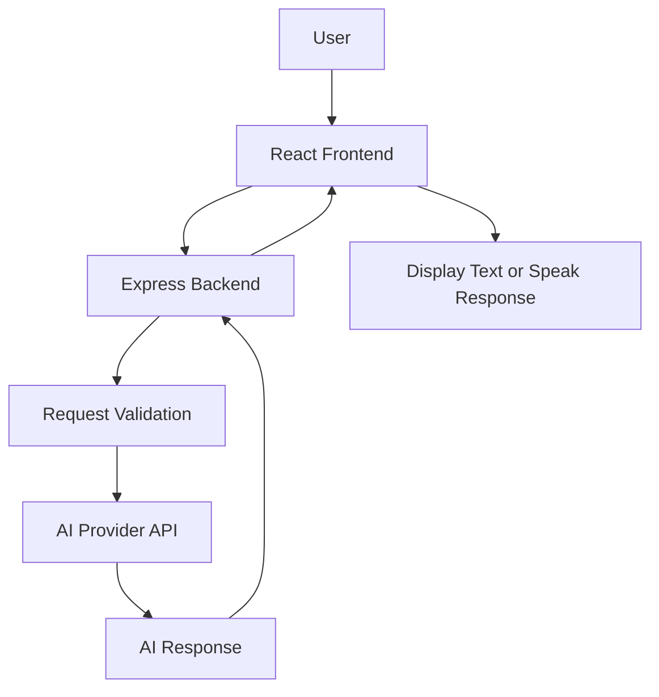

<div align="center">


<br/>

### ⚡ THINK SMARTER. SPEAK NATURALLY. DO MORE.

**An intelligent AI assistant designed to make conversations, learning, and everyday digital tasks easier.**

<br/>

<a href="https://github.com/ThirusenthilkumarC">

</a>


<br/><br/>

<a href="#-overview">Overview</a> • <a href="#-features">Features</a> • <a href="#-technology-stack">Tech Stack</a> • <a href="#-installation">Installation</a> • <a href="#-roadmap">Roadmap</a>

<br/><br/>


</div>

---

## 🌌 Overview

**NOVA AI** is a next-generation personal AI assistant project designed to bring intelligent conversations, voice interaction, coding assistance, and personalized digital experiences into one modern application.

Inspired by futuristic AI systems, NOVA aims to create a natural and interactive environment where users can ask questions, explore ideas, learn new concepts, and get assistance with everyday tasks.

With a sleek interface, responsive design, and AI-powered capabilities, NOVA is being developed to make artificial intelligence more accessible, intuitive, and enjoyable.

> 💡 **Our Vision:** Build a personal AI companion that makes technology feel more natural, intelligent, and human-friendly.

### ✨ What Makes NOVA Special?

* 🧠 Intelligent AI-powered conversations.
* 🎙️ Natural voice interaction.
* 🌍 Tamil and English conversation support.
* 💻 Programming and debugging assistance.
* 📚 Learning and educational support.
* 🌌 Futuristic, interactive user experience.
* 📱 Responsive interface for different devices.
* 🔐 Security-conscious API integration.

*The application is under development. Features will become available as they are implemented.*

---

## 🎯 Project Goals

| Goal                       | Description                               |
| -------------------------- | ----------------------------------------- |
| 🤖 Intelligent Interaction | Provide useful AI-generated responses.    |
| 🎙️ Voice Experience       | Enable voice-based communication.         |
| 🌐 Accessibility           | Build a simple, responsive interface.     |
| 📚 Learning Support        | Help users understand technical concepts. |
| 💻 Developer Support       | Assist with programming questions.        |
| 🔒 Secure Architecture     | Protect API credentials and user data.    |

---

## 🚀 Features

<div align="center">

|          💎 Feature         | 📝 Description                                             |
| :-------------------------: | ---------------------------------------------------------- |
|          💬 AI Chat         | Ask questions and receive AI-generated answers.            |
|        🎤 Voice Input       | Speak to NOVA using supported speech-recognition features. |
|       🔊 Voice Output       | Listen to responses using speech synthesis.                |
| 🌍 Multilingual Interaction | Designed for Tamil and English conversations.              |
|     💻 Coding Assistant     | Get coding explanations and debugging suggestions.         |
|      📚 Study Companion     | Explore subjects and understand difficult concepts.        |
|   📝 Conversation History   | Keep track of previous chats where supported.              |
|    ⚡ Responsive Interface   | Adapt the layout to desktop, tablet, and mobile screens.   |
|       🌌 Futuristic UI      | Experience a modern dark interface with glowing accents.   |
|   🛡️ Secure API Handling   | Keep AI provider credentials on the server.                |

</div>

---

## 🎨 Design Philosophy

NOVA AI combines futuristic aesthetics with practical usability.

### 🌈 Visual Identity

* **Theme:** Futuristic dark mode.
* **Primary Colors:** Electric blue, cyan, and violet.
* **Visual Effects:** Glassmorphism, subtle glow, and gradients.
* **Typography:** Modern, clean, and readable.
* **Animations:** Smooth transitions and interactive feedback.
* **Layout:** Minimal, responsive, and user-focused.

### 🪄 Planned Interface Elements

* 🔮 Animated AI orb.
* 💬 Modern conversational chat window.
* 🎙️ Interactive microphone button.
* ✨ Typing and response animations.
* 🧭 Sidebar for conversations and navigation.
* ⚙️ Settings and assistant preferences.
* 📱 Mobile-friendly navigation.

---

## 🛠️ Technology Stack

<div align="center">

### Frontend


### Backend


### Tools & Development


</div>

| Technology      | Purpose                                |
| --------------- | -------------------------------------- |
| React           | Component-based user interface         |
| Vite            | Frontend development and build tooling |
| TypeScript      | Type-safe application development      |
| Tailwind CSS    | Responsive styling                     |
| Node.js         | Backend runtime                        |
| Express.js      | API and server development             |
| AI Provider API | AI-generated responses                 |
| Web Speech API  | Browser-supported speech capabilities  |
| Git & GitHub    | Version control and collaboration      |

*The final technology stack may change as development progresses.*

---

## 🏗️ System Architecture

NOVA AI is planned around a frontend, backend, and AI service architecture.



### 🔄 How It Works

1. The user enters a message or provides voice input.
2. The frontend sends the request to the backend.
3. The backend validates the request.
4. The backend communicates with the configured AI provider.
5. The AI response is returned to the frontend.
6. NOVA displays the response or reads it aloud when voice output is enabled.

**Security principle:** AI provider credentials remain on the backend and are never exposed in client-side code.

---

## 📂 Project Structure

```text
nova-ai/
│
├── frontend/
│   ├── public/
│   ├── src/
│   │   ├── assets/
│   │   ├── components/
│   │   │   ├── ChatWindow.tsx
│   │   │   ├── ChatMessage.tsx
│   │   │   ├── VoiceButton.tsx
│   │   │   └── Sidebar.tsx
│   │   ├── pages/
│   │   ├── hooks/
│   │   ├── services/
│   │   ├── styles/
│   │   ├── App.tsx
│   │   └── main.tsx
│   ├── package.json
│   └── vite.config.ts
│
├── backend/
│   ├── src/
│   │   ├── routes/
│   │   ├── controllers/
│   │   ├── services/
│   │   ├── middleware/
│   │   └── server.js
│   ├── .env.example
│   └── package.json
│
├── .gitignore
├── LICENSE
└── README.md
```

*This is the proposed structure. Add files as the corresponding modules are implemented.*

---

## ⚙️ Installation

Follow these steps to set up the project locally.

### 📋 Prerequisites

Install the following:

* [Node.js](https://nodejs.org/)
* [Git](https://git-scm.com/)
* [Visual Studio Code](https://code.visualstudio.com/)

You will also need an API key from your chosen AI provider for cloud-based AI responses.

### 1️⃣ Clone the Repository

```bash
git clone https://github.com/ThirusenthilkumarC/nova-ai.git
```

### 2️⃣ Navigate to the Project

```bash
cd nova-ai
```

### 3️⃣ Install Frontend Dependencies

```bash
cd frontend
npm install
```

### 4️⃣ Start the Frontend

```bash
npm run dev
```

Open the local development URL displayed in the terminal.

### 5️⃣ Configure the Backend

Open another terminal from the project root.

```bash
cd backend
npm install
```

Create a `.env` file inside the `backend` folder:

```env
PORT=5000
AI_API_KEY=your_api_key_here
```

Replace the placeholder with your actual API key. The backend must be configured to read this variable and connect to your selected AI provider.

### 6️⃣ Start the Backend

```bash
npm run dev
```

The backend package must define a corresponding `dev` script.

> ⚠️ These instructions assume the proposed project structure and scripts have been created. Replace the example repository name if your actual GitHub repository uses a different name.

---

## 🔐 Security & Privacy

Security is an important part of NOVA AI.

* 🔑 Store API keys in server-side environment variables.
* 🚫 Never upload `.env` files or private credentials to GitHub.
* 🛡️ Validate user input on the backend.
* ⏳ Add rate limiting to prevent excessive requests.
* ⚠️ Handle API failures without exposing internal secrets.
* 🔒 Use HTTPS in production.
* 🧹 Avoid retaining sensitive user information unnecessarily.

**Privacy goal:** Build an assistant that handles user conversations responsibly and transparently.

---

## 🗺️ Roadmap

Our development journey is divided into progressive stages.

### 🟢 Phase 1 — Foundation

* [ ] Create the project repository.
* [ ] Configure React and Vite.
* [ ] Build the initial responsive interface.
* [ ] Design the NOVA AI visual identity.
* [ ] Create the Express backend.

### 🔵 Phase 2 — AI Integration

* [ ] Connect a supported AI provider.
* [ ] Implement the chat API.
* [ ] Display AI responses.
* [ ] Add loading states and error messages.
* [ ] Handle API limits and failures.

### 🟣 Phase 3 — Voice Intelligence

* [ ] Implement microphone input.
* [ ] Add speech-to-text functionality.
* [ ] Add text-to-speech responses.
* [ ] Improve Tamil and English interaction.
* [ ] Create voice interaction animations.

### 🟠 Phase 4 — Personalization

* [ ] Implement conversation history.
* [ ] Add assistant settings.
* [ ] Create reusable prompt presets.
* [ ] Improve the coding assistant experience.
* [ ] Add study-focused assistance.

### 🔴 Phase 5 — Production

* [ ] Test across different screen sizes.
* [ ] Improve accessibility.
* [ ] Add backend security protections.
* [ ] Deploy the frontend and backend.
* [ ] Publish a live demo.
* [ ] Document implemented features.

---

## 🔮 Future Enhancements

NOVA AI may expand into a more capable personal assistant with:

| Enhancement               | Planned Capability                                          |
| ------------------------- | ----------------------------------------------------------- |
| 🧠 Personalized Assistant | Configurable response preferences                           |
| 🗣️ Natural Voice Mode    | More interactive spoken conversations                       |
| 📄 Document Assistant     | Ask questions about uploaded documents                      |
| 🧑‍💻 Developer Mode      | Dedicated coding and debugging workflows                    |
| 📅 Productivity Tools     | Tasks, reminders, and planning                              |
| 🌐 Web Information        | Search integration for current information                  |
| 🖼️ Image Understanding   | Analyze supported image inputs                              |
| 🔌 Extensible Tools       | Connect additional services through controlled integrations |

These enhancements are future ideas, not currently available features.

---

## 🌍 Deployment

NOVA AI can be deployed using separate frontend and backend hosting services.

| Component   | Possible Platform |
| ----------- | ----------------- |
| Frontend    | Vercel            |
| Backend     | Render            |
| Source Code | GitHub            |

Before deploying:

1. Configure production environment variables.
2. Set the correct frontend API endpoint.
3. Configure backend CORS rules.
4. Keep API keys on the server.
5. Test all implemented features.
6. Review hosting limits and pricing.

---

## 🤝 Contributing

Contributions, suggestions, and feedback are welcome!

1. Fork the repository.
2. Create a feature branch.
3. Make your changes.
4. Test your implementation.
5. Submit a pull request.

Help make NOVA AI more useful, accessible, and enjoyable.

---

## 👨‍💻 About the Developer

<div align="center">

### Thirusenthilkumar C

**Full Stack Developer | UI/UX Enthusiast**

Interested in building modern web applications, exploring AI-powered experiences, and creating intuitive user interfaces.

<a href="https://github.com/ThirusenthilkumarC">

</a>

</div>

---

## 📜 License

This project is intended to use the MIT License. Add the appropriate `LICENSE` file to the repository before treating the project as officially licensed.

---

<div align="center">

## 💙 THE FUTURE IS INTERACTIVE.

### Meet NOVA AI.

**Your Voice. Your Intelligence. Your Assistant.**

<br/>


</div>
